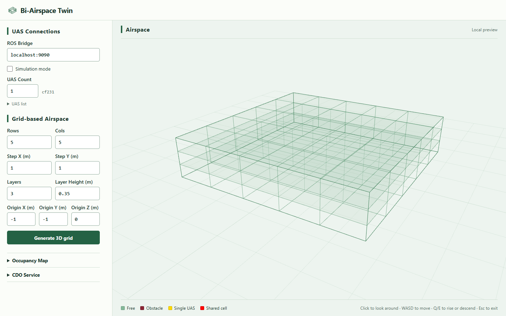
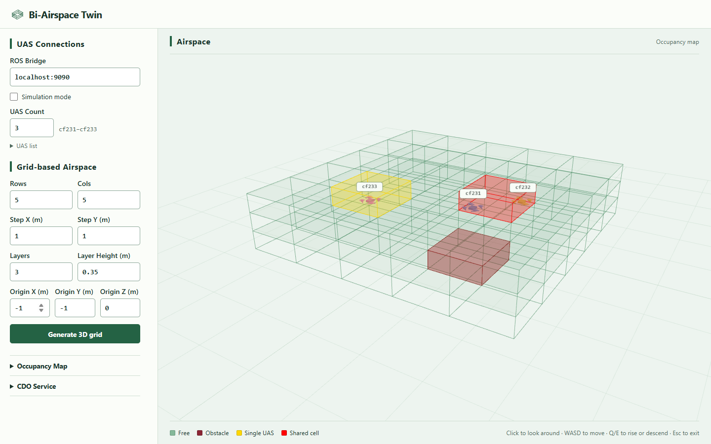

# Bi-Airspace Twin

A web-based viewer for 3D **bigrids**. It provides an interactive 3D environment for exploring bigrid based airspace.

### Features

- **3D Bigrid Generation**
  - Load sample models
  - Upload custom XMI files
  - Generate grids with a configurable X, Y, Z origin via the `bigrid-provider-service`
  - Fetch from a CDO repository
- **Live Monitoring**
  - Configure 1–30 UAS in the ROS2 connection panel
  - Visualize simulated or physical Crazyflie drone positions as a colored drone
  (via
  `cf.PyControl` [WebSocket integration](https://github.com/UniAgent-CyberPhysicalAssets/cps.asset.crazyflie/tree/main/controller/cf.PyControl))
- **3D Navigation**
  - Free-flight camera

**Screenshots**

| 3D airspace preview                                                        | Live occupancy colors                                                                                                 |
| -------------------------------------------------------------------------- | --------------------------------------------------------------------------------------------------------------------- |
|  |  |

## Getting Started

**Start the Web App:**

```shell
$ nvm install node --lts
$ nvm use --lts 
$ npm install
$ npm run dev
```

Open the browser at:
[`http://localhost:5173/`](http://localhost:5173/)

Press ESC to leave the 3D view and take back control.

### More Functions

- Start the [bigrid-provider-service](https://github.com/UniAgent-Platform/bigrid-provider-service) if you plan to
generate grids dynamically.
- Start the CDO server if you want to load models from a CDO repository.
See [here](https://github.com/bigraph-toolkit-suite/bigraphs-by-examples.vendingmachine-webservice/blob/main/src/test/java/org.example/CDOStandaloneServerTest.java)
and [here](https://github.com/bigraph-toolkit-suite/bigraphs-by-examples.vendingmachine-webservice/blob/main/src/main/java/org/example/service/CDOServerService.java)
for example.
- The ROS connector relies on [Crazyswarm2](https://github.com/UniAgent-CyberPhysicalAssets/cps.asset.crazyflie/tree/main/simulation/crazyswarm2-ext) and the [JAVA rosbridge](https://github.com/RobotWebTools/rosbridge_suite). Check the tutorial [here](https://bigraphs.org/software/bigraph-framework/tutorials/streamattributes/#prerequisites).

```shell
$ ros2 launch rosbridge_server rosbridge_websocket_launch.xml
```
